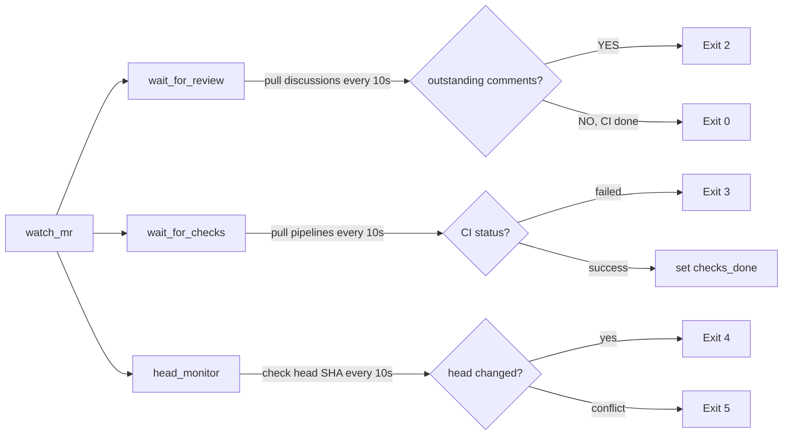

# Skills System

tasking supports opencode skill files (`.opencode/skills/<name>/SKILL.md`), providing structured operational guidance for the agent.

## Overview

Skill files are pre-placed in the development repo's `.opencode/skills/` directory, entering the workspace via the `after_create` hook's `git clone`. tasking does not inject skills through code — `injectMcpConfig` only writes `.opencode/opencode.json` (merge semantics) and never touches the skills directory.

## Built-in Skill Templates

The `assets/skills/` directory in the tasking repo provides 7 reference skill templates:

### commit

Standardized git commit. Builds the message from session context and `git diff`: analyze changes → pick a conventional type + scope → imperative subject ≤72 chars → body with summary + rationale → `git commit -F <file>`.

### pull

Merges `origin/main` into the feature branch and resolves conflicts. Enables rerere, uses the zdiff3 conflict style, resolves conflicts semantically, and verifies no leftover markers with `git diff --check`.

### push

Pushes the branch and creates/updates a GitLab MR. Uses `glab mr create` to create the MR and `glab mr view` to view info. When push is rejected, references the `pull` skill to sync.

**Prerequisite**: `glab` CLI installed and authenticated (`glab auth status`).

### debug

Correlates task execution issues via `tasking.log`. Uses `task_identifier` / `session_id` correlation keys, identifies dispatch → turn_started → turn_completed → timeout/stall lifecycle events, and classifies failure causes per the three-tier timeout model.

### land

GitLab MR landing flow. Uses the `land_watch.py` sensor to monitor CI and review, handles feedback by exit code, and merges with `glab mr merge --squash`.

**Core pattern**: the agent drives a loop within a single turn — run `land_watch.py` → read exit code → perform the corresponding action → re-run. The three-tier timeout model ensures the agent isn't killed by mistake during sustained activity.

**Prerequisite**: `glab` CLI + Python 3.

### install-glab

Idempotently installs the GitLab CLI. First checks `command -v glab`; if present, exits immediately; if missing, downloads the official linux/macOS binary via the GitLab CLI releases API to `~/.local/bin` (with `brew` / `snap` / `scoop` as fallbacks), then verifies `GITLAB_TOKEN`-based auth with `glab auth status`. Before any `glab` step, if `command -v glab` fails, the agent runs this skill first (`tasking init` installs it into the target repo's `.opencode/skills/` alongside `land`).

### jira

Jira interaction guide. Uses the `jira_rest` and `jira_upload_attachment` MCP tools to: query/perform state transitions, read/add comments, read/write attachments, add labels. Includes a State Flow section explaining the three-tier state model (active/review/terminal), dual-path review handling (incremental fix vs full reset), and per-phase transition responsibilities. Instructs the agent to query transitions first then pick the id by name, not hardcode ids, and not self-transition to a terminal state. See [State Flow](./state-flow.md).

## land_watch.py

`land_watch.py` is a one-shot sensor script for GitLab MR status. It runs once, detects a single state, reports via exit code, and exits. The agent is responsible for re-invoking it.

### Exit Code Protocol

| Exit Code | Meaning | Agent Action |
|-----------|------|-----------|
| 0 | CI green + no outstanding review | run `glab mr merge --squash` |
| 2 | outstanding review comments | handle comments → commit → push → re-run |
| 3 | CI failed | fix bug → commit → push → re-run |
| 4 | MR head changed | pull → amend → force-push → re-run |
| 5 | merge conflict | resolve conflict with the `pull` skill → push → re-run |

### Three-Way Concurrent Monitoring

## Usage

1. Copy skills from `assets/skills/` to the development repo's `.opencode/skills/` directory
2. Customize skill content per the repo's needs
3. Ensure the `after_create` hook runs `git clone` (the default config already includes this)
4. The prompt body of WORKFLOW.md references all 7 skills (pull/commit/push/debug/land/install-glab/jira)

## Customization

- Skills are bound to the code version; different repos can have different skills
- Just remove the skill directories you don't need
- `land_watch.py`'s GitLab project ID is auto-parsed from `glab mr view --output json`
- To configure different target branches for different branches, modify the `--target-branch` parameter in the `push` skill
