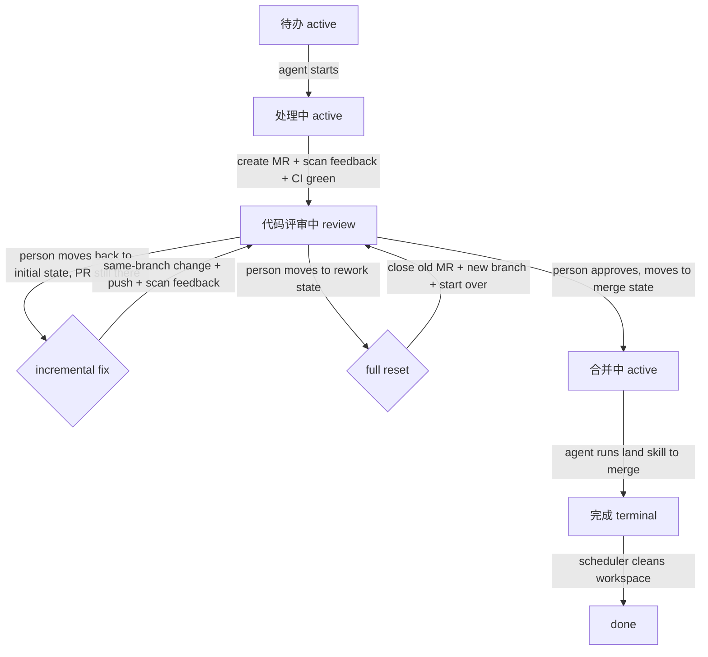
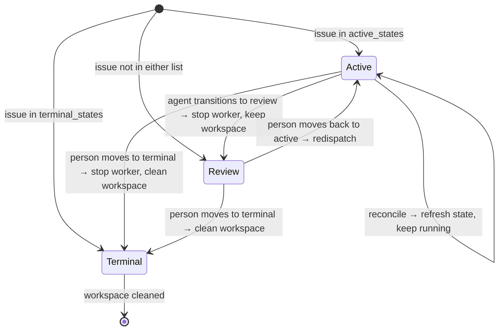

# State Flow

tasking's task state flow is based on a three-tier state bucket model, referencing Symphony's design. The scheduler decides behavior based on which state bucket a Jira issue is in: dispatch, stop, or clean up.

## Three-Tier State Model

| State Bucket | Config | Scheduler Behavior | Workspace |
|--------|------|-----------|--------|
| **active** | `tracker.active_states` | poll + dispatch + continue polling | retained |
| **review (implicit)** | not in either list | stop worker | **retained** |
| **terminal** | `tracker.terminal_states` | stop worker | **cleaned** |

The review state is implicit — any state **neither in `active_states` nor in `terminal_states`** automatically becomes a review state. The scheduler stops the worker but keeps the workspace, waiting for a human to decide the next step.

### Scheduler reconcile three branches

`reconcileTrackerStates` in `src/scheduler/scheduler.ts:509-529` implements the three branches:

```typescript
if (isTerminalState(task.state, ...)) {
    this.terminateRunning(task.id, true, "terminal");      // 清理工作区
} else if (isActiveState(task.state, ...)) {
    entry.task = task;                                       // 继续
} else {
    this.terminateRunning(task.id, false, "non-active");   // 保留工作区
}
```

The second parameter `cleanup` of `terminateRunning` controls whether the workspace is deleted (`scheduler.ts:544-561`).

## Complete Flow Paths



## Three-Tier State Bucket to Scheduler Behavior Mapping



## Dual-Path Review Handling

Which state a person moves the issue to after review determines the path:

### Incremental fix (person moves back to the initial active state, PR still there)

```
代码评审中 (review) → 人移到 待办 (active, PR 还在) → agent 被重新派发
→ 读 Jira 评论 → 同分支改 → push → 扫完反馈 → 转回 代码评审中
```

- Doesn't close the MR, doesn't switch the branch
- The agent reads reviewer comments and handles or replies one by one
- Suitable for small fixes

### Full reset (person moves to the rework active state)

```
代码评审中 (review) → 人移到 重置处理 (active) → agent 被重新派发
→ 读 issue 全文 + 所有评论 → 关旧 MR → 从 origin/main 创新分支 → 从头来 → 转回 代码评审中
```

- Closes the old MR, creates a new branch
- "full approach reset, not incremental patching"
- Suitable when the direction is wrong, or for major changes

Both paths can loop for multiple rounds, until the person approves → moves to the merge active state → the agent runs the `land` skill → merges → transitions to the terminal state.

## Agent Stop and Wake Mechanism

### How the worker stops (`runner.ts:338-344`)

After each successful turn, the worker rechecks the issue state:

```typescript
if (opts.trackerStateChecker) {
    const refreshed = await opts.trackerStateChecker(currentTask);
    if (!refreshed) {
        lastStatus = "succeeded";   // 标记为正常退出
        break;                      // 不再启动下一个 turn
    }
}
```

`trackerStateChecker` (`scheduler.ts:259-264`) checks whether the issue is still in `active_states`:

```typescript
if (!isActiveState(fresh.state, config.tracker.active_states)) return null;
```

The agent transitions the issue to the review state (not in active_states) → `trackerStateChecker` returns null → the worker exits.

### How the scheduler avoids redispatch (`scheduler.ts:405-460`)

After the worker exits → continuation retry triggers after ~1s → `fetchCandidateIssues` only pulls active_states → the review state is not among them → no redispatch → the claim is released.

### How the agent is re-awakened

The person moves the issue back to active → next tick → `fetchCandidateIssues` picks it up → fresh dispatch (`attempt: null`, new opencode session) → continues in the **same workspace** (because the workspace was never cleaned).

## Configuration Example

```yaml
tracker:
  review_state: 代码评审中  # review 交接态，不放在 active/terminal 列表中
  active_states:
    - 待办        # 初始态 / 增量修复入口（PR 还在时）
    - 处理中      # 工作中态
    - 合并中      # 合并态（land 技能）
    - 重置处理    # 全量重置态（方向错了）
  terminal_states:
    - 完成
    - 关闭
    - 取消
# 代码评审中 不放任何列表 → 自动成为隐式 review 态
# review_state 字段注入 prompt 模板，agent 据此知道转入哪个具体状态
```

### State Description

| Jira State | State Bucket | Agent Behavior |
|-----------|--------|-----------|
| 待办 | active | Initial state. After dispatch, transitions to "处理中" to start work |
| 处理中 | active | Working state. Implements code, creates MR, scans feedback, then transitions to "代码评审中" |
| 代码评审中 | review (implicit) | Stopped. Waiting for person to review |
| 合并中 | active | Moved here after person approves. Agent runs the `land` skill to merge, then transitions to "完成" |
| 重置处理 | active | Person requests full reset. Agent closes old MR, creates new branch, starts over, then transitions back to "代码评审中" |
| 完成 | terminal | Terminal state. Scheduler cleans the workspace |

## grill-openspec workflow variant

`--workflow grill-openspec` (template `assets/workflows/WORKFLOW.grill-openspec.md.example`) reuses the same three-tier state bucket model, but the prompt body has the agent **self-judge phase by artifacts** within the active state (not by specific state names):

```mermaid
flowchart TD
    A["initial active (any)"] -->|phase 1 grill: send grill comment| R1[代码评审中 review]
    R1 -->|person answers comment, moves back to active| B["implement active (any)"]
    B -->|phase 2: propose+implement+create MR| R2[代码评审中 review]
    R2 -->|person reviews MR, moves to '合并中' semantic active| C["merge active"]
    C -->|phase 3: land merge MR + archive| G[完成 terminal]
    R2 -->|person moves to 'rework' semantic active| B2["full reset active"]
    B2 -->|close old MR + new branch + re-implement per existing change| R2
    R2 -->|person moves back to 'initial' semantic active (incremental fix)| B
```

Key points:

- **Phase judgment is artifact-driven**: presence of `CONTEXT.md` / grill comment / openspec change / MR; if uncertain, check Jira comments; if still uncertain, escalate during the run (send a grill comment to transition to review).
- **No hardcoded state names**: the prompt only uses `{{ active_states }}` / `{{ review_state }}` / `{{ terminal_states }}`; for the merge-MR signal, prefer state semantics, don't query glab MR approval status.
- **grill phase creates no MR, no openspec change**: only sends a grill comment (marker heading `## 🔍 拷问 / Grill Questions`) to transition to review; if there are no questions, proceed directly to implement.
- **Rework doesn't re-grill**: incremental fix (MR still there) modifies the same branch; full reset closes the old MR, creates a new branch, and re-implements per the existing openspec change. Plans (CONTENT/ADR/openspec change) survive.
- **Unanswered grill questions default to the recommendation**: the agent provides a recommended answer for each question; unanswered ones adopt the recommendation (marked); only truly blocking ones escalate for re-send.
- **opsx-archive is workspace wrap-up**: the openspec change's long-term retention relies on the implement phase committing into the feature branch and the MR merging into upstream; the workspace is still deleted by the scheduler in terminal state (same as the default workflow).

Phase routing is entirely within the prompt body; the runtime (scheduler/runner/prompt rendering) is unchanged. Known limitation: `buildContinuationGuidance` for turn 2+ is slightly off in the grill phase (see `docs/known-issues.md`).

## Feishu ↔ Jira Comment Bridge (CommentBridge)

Feishu becomes a comment sync mirror for existing Jira issues (ADR 0002), as a sibling component alongside the scheduler: `CommentBridge` (self-contained timer, dependency injection, runtime unchanged).

**Both issue sources create bindings (1 issue ↔ 1 Feishu topic, no fan-out):**

- Feishu-origin: the person sends `/issue <title>\n<desc>` in the intake group → `createIssue` (title→summary, desc→description field; project/assignee/labels locked to reuse `tracker.*` to ensure pickup by `buildJql`/`isRoutable`; type defaults to `feishu.create_issue_type`, overridable via `--type`) → that `/issue` command message becomes the topic root and writes the binding. After creation, the scheduler picks it up and dispatches it like any other issue.
- Jira-origin: the scheduler dispatches (`dispatch` event) → `CommentBridge` posts a "📋 {key} · {title} started" announcement in the intake group as the root and writes the binding (skipped if already bound).

**Bidirectional sync (each tick, directed polling of bound topics):**

- Jira→Feishu: pulls comments with `id > last_jira_comment_id`; those with a sentinel (`via 飞书 [msg:]`, bridged over) are skipped (not re-sent) but still advance the cursor; those without a sentinel are forwarded as topic replies (agent→`🤖 agent:`, person direct-to-Jira→`💬 {name} (Jira):`).
- Feishu→Jira: pulls topic messages with `msg > last_feishu_msg_id`; bot-authored (`sender_type=app`, including operation acks) skipped, `/` commands skipped (handled as commands), human free-text is bridged into a sentinel-tagged Jira comment and a topic reply receipt is posted (success `✅ 已收到，已同步到 {issue_key}` / failure `⚠️ 同步失败，请稍后重试`).

**Command surface** (pure commands, no LLM): `/issue` (intake group, create issue), `/state` (inside a bound topic, with no arg lists the issue's available transition numbers — at runtime queries Jira `GET /issue/{key}/transitions`, no hardcoded state names; `/state <N|name>` nudges the scheduler immediately after the transition, reusing `requestRefresh`), `/help`.

**Terminal wrap-up**: scheduler `terminate` event → posts a "✅ 已完结" ack + marks binding `terminal` + stops sync; reopen (state back to active) flips status back to `active` and continues on the same topic.

Inbound uses REST polling, no public port, zero new dependencies (ADR 0003); dedup uses a visible sentinel (ADR 0004, enforced via shared Jira credentials). v1 is plain text only (image/edit/delete sync deferred).
