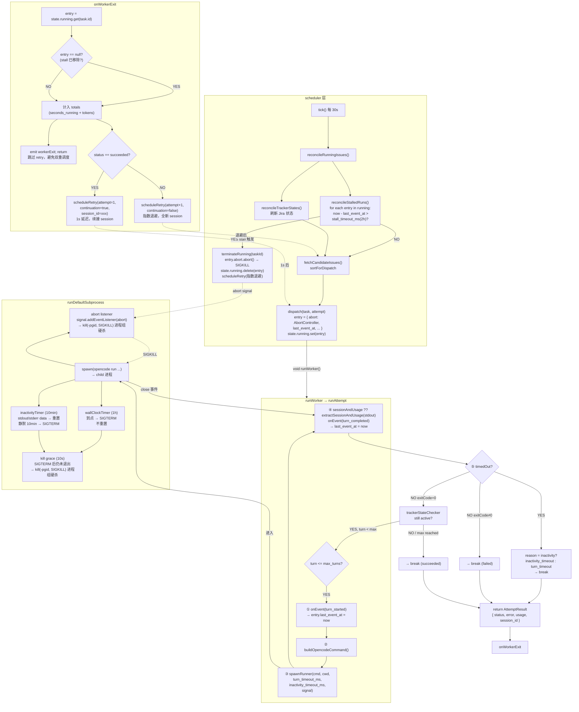
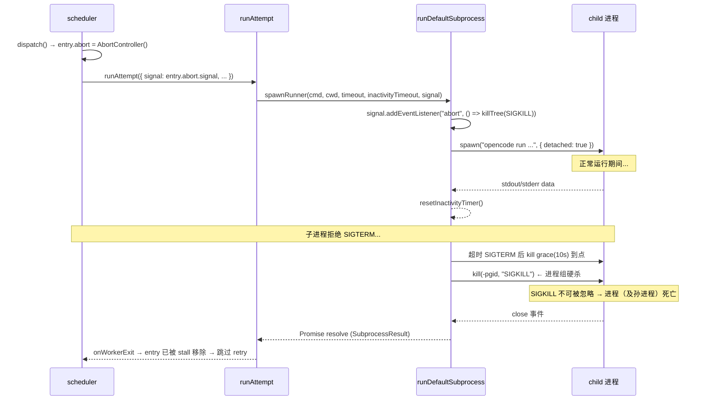
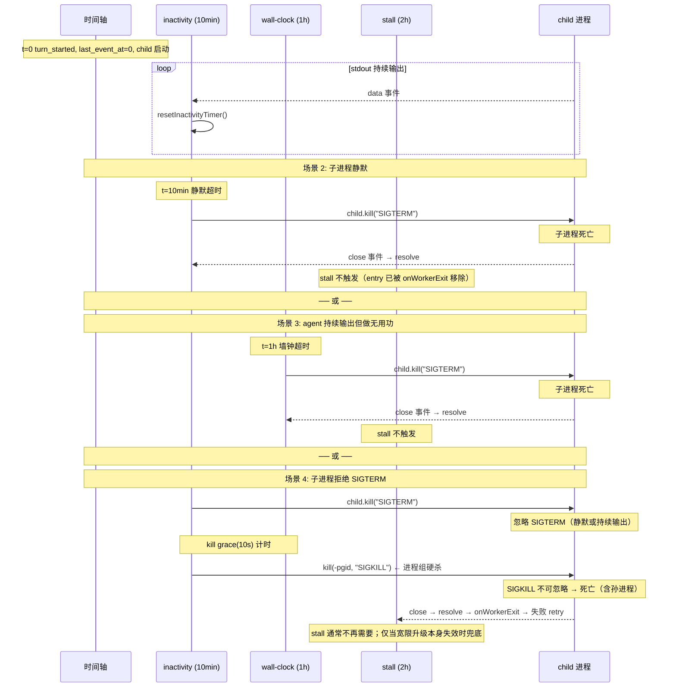

# Three-Layer Timeout Model

> **Updated in 0.7**: the worker now drives opencode v2 sessions through `opencode api` (ADR 0035); subprocesses and process-group kills are gone, and timeouts/aborts use the interrupt ladder (`session.interrupt` → short grace → clean up residual api processes). The subprocess-layer/process-group-SIGKILL mechanics below describe 0.6.x (the `support/v1` branch); the v2 timer matrix lives in [Architecture](./architecture.md) and ADR 0037.

The tasking worker subprocess (`opencode run`) uses three layers of timeout protection. Each layer operates independently; whichever triggers first terminates the subprocess. Subprocess-layer timeouts escalate: SIGTERM for graceful exit → 10s kill grace → process-group SIGKILL (see ADR 0020).

## Model Overview

```
┌─ scheduler 层 ──────────────────────────────────────────────────┐
│                                                                 │
│  stall_timeout_ms（2h）                                         │
│  检测：worker 是否卡死（entry 是否长期滞留 running map）         │
│  终止：通过 AbortSignal → runDefaultSubprocess → SIGKILL        │
│  retry：指数退避，全新 session                                   │
│                                                                 │
├─ subprocess 层（runDefaultSubprocess 内部）─────────────────────┤
│                                                                 │
│  inactivity_timeout_ms（10min）    turn_timeout_ms（1h）        │
│  检测：stdout/stderr 原始字节      检测：总时长                │
│  终止：SIGTERM → 10s 宽限 → 进程组 SIGKILL（两者相同）          │
│  retry：onWorkerExit 失败 retry    retry：onWorkerExit 失败 retry│
│                                                                 │
└─────────────────────────────────────────────────────────────────┘
```

## Overall Flow Diagram



## Signal Chain Detail Diagram



## Three-Layer Trigger Order



## Configuration Fields

| Field | Default | Validation | Disable | Layer |
|------|--------|------|------|------|
| `inactivity_timeout_ms` | 600000（10min） | >= 0 | Set to 0 | subprocess |
| `turn_timeout_ms` | 3600000（1h） | > 0 | Cannot be disabled | subprocess |
| `stall_timeout_ms` | 7200000（2h） | >= 0 | Set to 0 | scheduler |

It is recommended that `stall_timeout_ms` > `turn_timeout_ms`, ensuring stall only acts as a fallback when both wall-clock and inactivity have failed.

## Layer Details

### Layer 1: Inactivity Timeout (inactivity_timeout_ms)

**Location**: `src/worker/runner.ts` → `runDefaultSubprocess`

**Mechanism**: The timer is reset when stdout/stderr data is received; if silent beyond the threshold, it terminates with SIGTERM.

```
子进程启动 → 启动 inactivityTimer（10min）
  ├─ stdout 有数据 → resetInactivityTimer()（清零重开）
  ├─ stderr 有数据 → resetInactivityTimer()（清零重开）
  ├─ ...持续有数据，计时器不断重置...
  └─ 10min 内零数据 → timer 触发
     → timedOut = true, timedOutReason = "inactivity"
     → child.kill("SIGTERM")（仅父进程，给 opencode 优雅清理其子进程的机会）
     → 10s 内未退出 → kill(-pgid, "SIGKILL") 进程组硬杀（宽限幂等，只设一次）
```

**Design intent**: opencode may not produce stdout during tool execution (e.g. `npm test`, `land_watch.py`). 10 minutes leaves enough margin for common tool execution while still catching model API hangs and network disconnections.

**Symphony correspondence**: Symphony's `turn_timeout_ms` (app-server layer) uses Erlang `receive ... after` to implement the same inactivity semantics. tasking implements equivalent behavior with Node.js `setTimeout` + data event resets.

### Layer 2: Wall-Clock Timeout (turn_timeout_ms)

**Location**: `src/worker/runner.ts` → `runDefaultSubprocess`

**Mechanism**: Timed from subprocess startup; kills on expiry and is not reset by activity.

```
子进程启动 → 启动 wallClockTimer（1h）
  ├─ 子进程正常退出 → close 事件 → clearTimeout(wallClockTimer)
  ├─ 不活跃超时先触发 → SIGTERM → 子进程退出 → close → clearTimeout
  └─ 1h 到了 → timer 触发
     → timedOut = true, timedOutReason = "wall_clock"
     → child.kill("SIGTERM")（仅父进程）
     → 10s 内未退出 → kill(-pgid, "SIGKILL") 进程组硬杀
```

**Design intent**: Catches the scenario where "the agent is doing useless work but keeps producing output" (e.g. repeatedly calling tools in an infinite loop), which neither inactivity nor stall can catch.

### Layer 3: Stall Timeout (stall_timeout_ms)

**Location**: `src/scheduler/scheduler.ts` → `reconcileStalledRuns`

**Mechanism**: Each poll cycle (default 30s) checks `RunningEntry.last_event_at`; if it exceeds the threshold, the subprocess is terminated via AbortSignal.

```
每个 tick（30s）→ reconcileStalledRuns():
  for each entry in state.running:
    lastActivity = entry.last_event_at ?? entry.started_at
    if now - lastActivity > stall_timeout_ms:
      → terminateRunning(taskId, false, "stalled")
        → entry.abort.abort()  ← AbortController 触发
        → state.running.delete(taskId)  ← 释放 slot
      → scheduleRetry(attempt+1, "stalled", false)  ← 指数退避
```

**`last_event_at` update timing**: Updated only when `runAttempt` emits `turn_started` / `turn_completed` via the `onEvent` callback. Not updated during turn execution.

**AbortSignal signal chain**:

```
scheduler dispatch()
  → entry.abort = new AbortController()
  → runWorker: signal: entry.abort.signal → runAttempt(opts)
    → spawnRunner(cmd, cwd, timeout, inactivityTimeout, opts.signal)
      → runDefaultSubprocess(cmd, cwd, timeout, inactivityTimeout, signal)
        → signal.addEventListener("abort", () => kill(-pgid, "SIGKILL"))
        → stall 触发 entry.abort.abort() → 信号到达 → 进程组 SIGKILL
```

**Design intent**: The subprocess-layer kill grace (SIGTERM → 10s → process-group SIGKILL) already caps a TERM-refusing subprocess's slot occupancy at a hard "timeout + 10s" bound, so stall returns to being a true last resort: it catches total subprocess-layer failure (event loop deadlock, the escalation path itself failing, `spawnRunner` never returning on an exception) by detecting long-stuck entries externally from the scheduler layer and group-killing via AbortSignal, releasing the slot and re-scheduling.

## Scenario Flows

### Scenario 1: Normal Completion

```
t=0       dispatch → entry 创建 → runWorker → runAttempt
          → turn_started 事件 → last_event_at = 0
          → spawnRunner → runDefaultSubprocess → 子进程启动

t=2min    子进程正常退出（exitCode=0）
          → close 事件 → clearTimeout(wallClockTimer) + clearTimeout(inactivityTimer)
          → Promise resolve → spawnRunner 返回
          → turn_completed 事件 → last_event_at 更新
          → onWorkerExit → entry 仍在 running map → status=succeeded
          → scheduleRetry(attempt=1, continuation=true, session_id=xxx)
          → 1s 后 continuation retry

          wall-clock(1h) 不触发 ✅
          inactivity(10min) 不触发 ✅
          stall(2h) 不触发 ✅
```

### Scenario 2: Inactivity Timeout

```
t=0       turn_started → last_event_at = 0 → 子进程启动
          → opencode 开始工作，持续输出 JSON events

t=3min    agent 调用长时间工具（如 npm test），opencode 等待工具完成
          → stdout 无输出 → inactivityTimer 不重置

t=10min   inactivityTimer 触发
          → timedOut=true, timedOutReason="inactivity"
          → child.kill("SIGTERM") → 子进程死亡（宽限内优雅退出，不升级组杀）
          → close 事件 → clearTimeout(wallClockTimer + graceTimer)
          → Promise resolve → spawnRunner 返回
          → runAttempt: result.timedOut=true
            → lastStatus="timed_out"
            → lastError="turn N timed out (inactivity_timeout)"
          → onWorkerExit → entry 仍在 running map
            → status=timed_out（非 succeeded）
            → scheduleRetry(attempt+1, continuation=false) ← 指数退避，全新 session

t=10min+ε 下个 tick → stall 检查 running map → entry 已不在（onWorkerExit 移除了）
          → stall 不触发 ✅
```

### Scenario 3: Wall-Clock Timeout

```
t=0       turn_started → 子进程启动
          → agent 持续输出（inactivity 不触发）
          → 但一直在做无用功（如死循环调工具）

t=1h      wallClockTimer 触发
          → timedOut=true, timedOutReason="wall_clock"
          → child.kill("SIGTERM") → 子进程死亡（宽限内优雅退出，不升级组杀）
          → close 事件 → clearTimeout(inactivityTimer + graceTimer)
          → Promise resolve → spawnRunner 返回
          → runAttempt: lastError="turn N timed out (turn_timeout)"
          → onWorkerExit → scheduleRetry(attempt+1, continuation=false)

t=1h+ε    stall 检查 → entry 已不在 → 不触发 ✅
```

### Scenario 4: SIGTERM Refused (silent or still outputting) — grace escalation group-kills

```
t=0       turn_started → 子进程启动

t=10min   inactivityTimer 触发 → child.kill("SIGTERM")（仅父进程）
          → 子进程忽略 SIGTERM（D 状态/信号捕获）
          → 无 close 事件 → kill grace(10s) 计时开始（幂等，只设一次）

t=10min+10s 宽限到点，子进程仍未退出
          → kill(-pgid, "SIGKILL") ← 进程组硬杀，SIGKILL 不可被忽略
          → 子进程与其孙进程一并终止（不再有孤儿泄漏）
          → close 事件 → Promise resolve → spawnRunner 返回
          → runAttempt: lastError="turn N timed out (inactivity_timeout)"
          → onWorkerExit → scheduleRetry(attempt+1, 指数退避) ← 正常失败 retry

          stall(2h) 不触发 ✅ —— slot 占用被压到"超时 + 10s"硬上界

Notably, if the subprocess refuses SIGTERM but keeps emitting token events
(e.g. a wrapper that traps the signal and keeps running), those events keep
refreshing last_event_at — in the old design stall therefore never fired and
the slot was held indefinitely; the grace escalation is output-independent
and still group-kills after 10s, closing that hole.

（stall 仍保留为最后兜底：若宽限升级路径自身失效——事件循环卡死、
close 事件不产生——entry 长期滞留 running map 时由 scheduler 组杀释放）
```

### Scenario 5: Worker Stuck (spawnRunner Never Returns)

```
t=0       turn_started → 子进程启动
          → 子进程在 spawn() 阶段就卡死（如 fork 失败但未报错）
          → runDefaultSubprocess 的 Promise 永不 resolve

t=10min   inactivityTimer 触发 → child.kill("SIGTERM")
          → 无子进程可杀 / 子进程不响应
          → 无 close 事件 → Promise 不 resolve

t=1h      wallClockTimer 触发 → child.kill("SIGTERM")
          → 同样无效

t=2h      stall 检测 → terminateRunning
          → entry.abort.abort() → AbortSignal → kill(-pgid, "SIGKILL") 进程组硬杀
          → 子进程被杀（或本就无进程）→ close/不产生
          → 如果 close 事件产生 → Promise resolve → onWorkerExit → 跳过 retry
          → 如果 close 事件不产生 → Promise 仍不 resolve
            但 entry 已从 running map 移除 → slot 释放
            scheduleRetry 已调度 → 任务有重试机会

          abort 走进程组硬杀，正常路径不再遗留孤儿孙进程
```

## Error Classification

| Timeout layer | Error category | AttemptStatus | Trigger condition |
|--------|---------|---------------|---------|
| Inactivity | `inactivity_timeout` | `timed_out` | No stdout/stderr data for 10min |
| Wall-clock | `turn_timeout` | `timed_out` | Subprocess total time exceeds 1h |
| stall | `stalled` | (scheduler terminates directly) | Worker has no event exit for 2h |

`AttemptResult.error` format:
- `turn N timed out (inactivity_timeout)`
- `turn N timed out (turn_timeout)`
- `stalled` (set by scheduler)

## Retry Behavior Comparison

| Trigger source | continuation | Delay | session_id | attempt |
|--------|-------------|------|-----------|---------|
| Normal exit (incl. max_turns) | true | 1s | passed (continuation) | reset to 1 |
| Inactivity/Wall-clock timeout | false | Exponential backoff | not passed (brand-new) | +1 |
| stall | false | Exponential backoff | not passed (brand-new) | +1 |

Exponential backoff formula: `10s × 2^(attempt-1)`, capped at `max_retry_backoff_ms` (default 5min).

## onWorkerExit Guard

```typescript
private onWorkerExit(task: Task, result: AttemptResult): void {
    const entry = this.state.running.get(task.id);
    this.state.running.delete(task.id);

    // 计入 totals（即使 entry 为 null，token 仍需统计）
    this.state.totals.seconds_running += elapsed;
    this.state.totals.input_tokens += result.usage.input_tokens;
    // ...

    // 如果 entry 已被 stall 移除，跳过 retry（stall 已调度）
    if (!entry) {
        this.emit("workerExit", task.id, result.status);
        return;
    }

    // 正常路径：根据结果调度 retry
    if (normal) scheduleRetry(..., continuation=true, session_id=...);
    else scheduleRetry(..., continuation=false);
}
```

This prevents the **double retry** problem caused by the subprocess exiting late after stall has triggered.

## File Index

| File | Responsibility |
|------|------|
| `src/config/config-types.ts` | `OpencodeConfig` interface + `DEFAULTS` |
| `src/config/resolver.ts` | Config resolution (`asNumber` + validation) |
| `src/worker/runner.ts` | `runDefaultSubprocess` (inactivity + wall-clock + abort listener), `runAttempt` (turn loop + classification) |
| `src/scheduler/scheduler.ts` | `reconcileStalledRuns` (stall detection), `terminateRunning` (abort + remove), `onWorkerExit` (guard + retry) |
| `src/shared/types.ts` | `RunningEntry` (`last_event_at`, `abort`), `AttemptStatus` |
