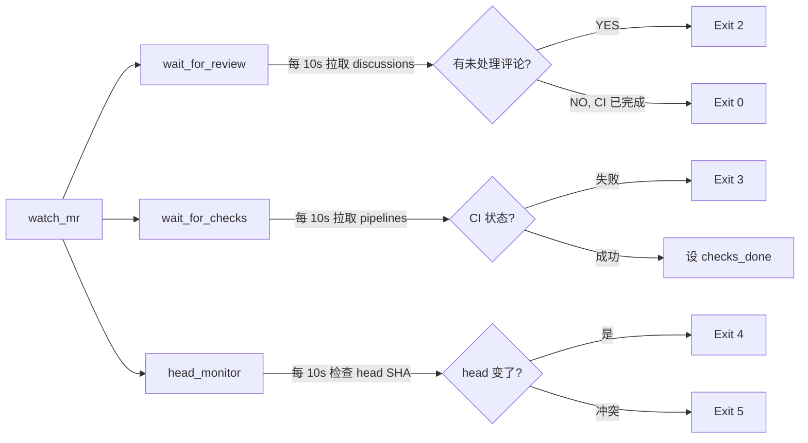

# 技能系统

tasking 支持 opencode 技能文件（`.opencode/skills/<name>/SKILL.md`），为 agent 提供结构化的操作指引。

## 概述

技能文件预放在开发仓库的 `.opencode/skills/` 目录中，随 `after_create` hook 的 `git clone` 进入 workspace。tasking 不通过代码注入技能——`injectMcpConfig` 只写 `.opencode/opencode.json`（merge 语义），不碰 skills 目录。

## 内置技能模板

tasking 仓库的 `assets/skills/` 目录提供 7 个参考技能模板：

### commit

规范化 git commit。从 session 上下文和 `git diff` 构建消息：分析变更 → 选择 conventional type + scope → imperative subject ≤72 字符 → body 含 summary + rationale → `git commit -F <file>`。

### pull

merge `origin/main` 到特性分支并解决冲突。启用 rerere、使用 zdiff3 冲突风格、按语义解决冲突、`git diff --check` 验证无残留标记。

### push

push 分支并创建/更新 GitLab MR。使用 `glab mr create` 创建 MR，`glab mr view` 查看信息。push 被拒绝时引用 `pull` 技能同步。

**前置条件**：`glab` CLI 已安装并认证（`glab auth status`）。

### debug

通过 `tasking.log` 关联追踪任务执行问题。使用 `task_identifier`/`session_id` 关联键，识别 dispatch → turn_started → turn_completed → timeout/stall 生命周期事件，按三层超时模型分类失败原因。

### land

GitLab MR 落地流程。使用 `land_watch.py` 传感器监控 CI 和 review，根据 exit code 处理反馈，`glab mr merge --squash` 合并。

**核心模式**：agent 在单 turn 内驱动循环——运行 `land_watch.py` → 读取 exit code → 执行对应操作 → 重新运行。三层超时模型保证 agent 在持续活动时不会被误杀。

**前置条件**：`glab` CLI + Python 3。

### install-glab

幂等安装 GitLab CLI。先检测 `command -v glab`，已存在直接结束；缺失时经 GitLab CLI releases API 下载官方 linux/macOS 二进制到 `~/.local/bin`（`brew`/`snap`/`scoop` 作降级），再用 `glab auth status` 验证经 `GITLAB_TOKEN` 认证。agent 在任何 `glab` 步骤前若 `command -v glab` 失败即先运行此技能（`tasking init` 会连同 `land` 一并装入目标仓库 `.opencode/skills/`）。

### jira

Jira 交互指南。使用 `jira_rest` 和 `jira_upload_attachment` MCP 工具完成：查询/执行状态转换、读/加评论、读/写附件、添加标签。包含 State Flow 小节，解释三层状态模型（active/review/terminal）、双路径 review 处理（增量修复 vs 全量重置）、各阶段转换职责。指示 agent 先查 transitions 再按名称选 id，不硬编码 id，不自行 transition 到终态。详见 [状态流转](./state-flow.md)。

## land_watch.py

`land_watch.py` 是 GitLab MR 状态的一次性传感器脚本。它运行一次、检测一个状态、用 exit code 报告、退出。agent 负责重新调用它。

### Exit code 协议

| Exit Code | 含义 | Agent 动作 |
|-----------|------|-----------|
| 0 | CI 绿 + 无未处理 review | 执行 `glab mr merge --squash` |
| 2 | 有未处理 review 评论 | 处理评论 → commit → push → 重跑 |
| 3 | CI 失败 | 修 bug → commit → push → 重跑 |
| 4 | MR head 变化 | pull → amend → force-push → 重跑 |
| 5 | 合并冲突 | 用 `pull` 技能解冲突 → push → 重跑 |

### 三路并发监控

## 使用方式

1. 将 `assets/skills/` 下的技能复制到开发仓库的 `.opencode/skills/` 目录
2. 根据仓库需求定制技能内容
3. 确保 `after_create` hook 执行 `git clone`（默认配置已包含）
4. WORKFLOW.md 的 prompt body 引用全部 7 个技能（pull/commit/push/debug/land/install-glab/jira）

## 定制

- 技能跟代码版本绑定，不同仓库可以有不同技能
- 去掉不需要的技能目录即可
- `land_watch.py` 的 GitLab project ID 从 `glab mr view --output json` 自动解析
- 如需为不同分支配置不同 target branch，修改 `push` 技能中的 `--target-branch` 参数
