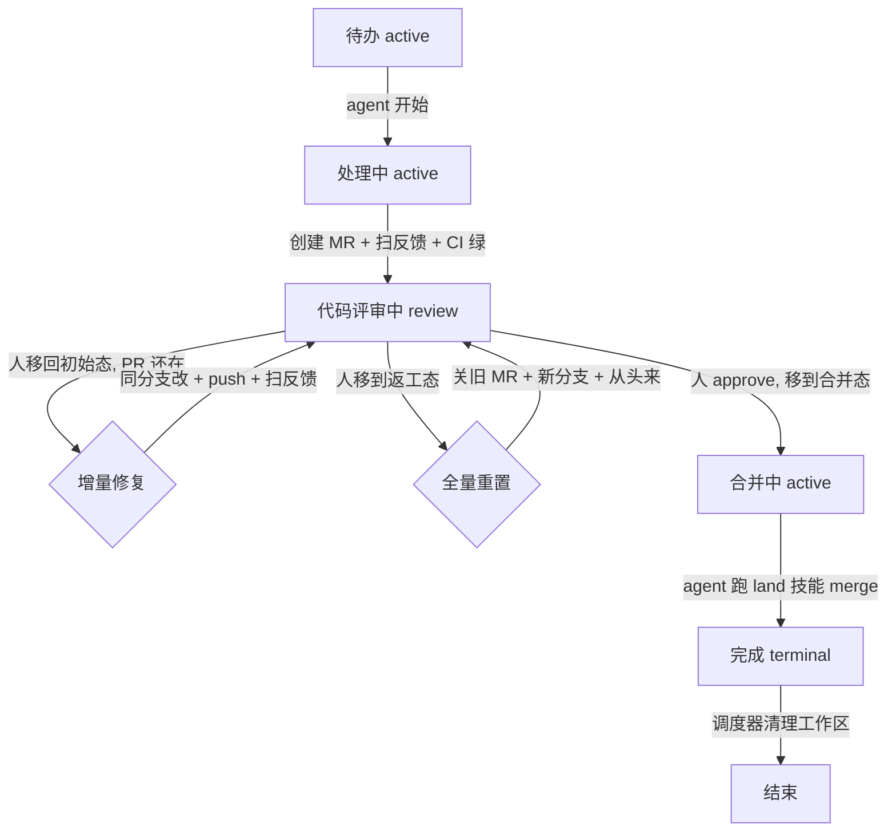
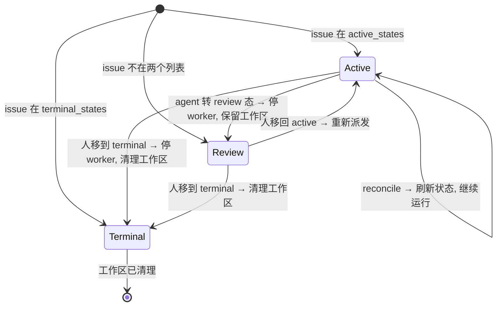

# 状态流转

tasking 的任务状态流转基于三层状态桶模型，参照 Symphony 的设计。调度器根据 Jira issue 所处的状态桶决定行为：派发、停止或清理。

## 三层状态模型

| 状态桶 | 配置 | 调度器行为 | 工作区 |
|--------|------|-----------|--------|
| **active** | `tracker.active_states` | 轮询 + 派发 + 续轮 | 保留 |
| **review（隐式）** | 不在两个列表中 | 停止 worker | **保留** |
| **terminal** | `tracker.terminal_states` | 停止 worker | **清理** |

review 态是隐式的——任何**既不在 `active_states` 也不在 `terminal_states`** 中的状态自动成为 review 态。调度器停止 worker 但保留工作区，等人决定下一步。

### 调度器 reconcile 三分支

`src/scheduler/scheduler.ts:509-529` 的 `reconcileTrackerStates` 实现三分支：

```typescript
if (isTerminalState(task.state, ...)) {
    this.terminateRunning(task.id, true, "terminal");      // 清理工作区
} else if (isActiveState(task.state, ...)) {
    entry.task = task;                                       // 继续
} else {
    this.terminateRunning(task.id, false, "non-active");   // 保留工作区
}
```

`terminateRunning` 的第二个参数 `cleanup` 控制是否删除工作区（`scheduler.ts:544-561`）。

## 完整流转路径



## 三层状态桶与调度器行为映射



## 双路径 review 处理

人 review 后把 issue 移到哪个状态决定路径：

### 增量修复（人移回初始 active 态，PR 还在）

```
代码评审中 (review) → 人移到 待办 (active, PR 还在) → agent 被重新派发
→ 读 Jira 评论 → 同分支改 → push → 扫完反馈 → 转回 代码评审中
```

- 不关 MR、不换分支
- agent 读 reviewer 评论，逐条处理或回复
- 适合小修小补

### 全量重置（人移到返工 active 态）

```
代码评审中 (review) → 人移到 重置处理 (active) → agent 被重新派发
→ 读 issue 全文 + 所有评论 → 关旧 MR → 从 origin/main 创新分支 → 从头来 → 转回 代码评审中
```

- 关旧 MR、创新分支
- "full approach reset, not incremental patching"
- 适合方向错了、大改

两条路都可循环多轮，直到人 approve → 移到合并 active 态 → agent 跑 `land` 技能 → merge → 转入 terminal 态。

## agent 停止与唤醒机制

### worker 如何停止（`runner.ts:338-344`）

每个 turn 成功后，worker 回查 issue 状态：

```typescript
if (opts.trackerStateChecker) {
    const refreshed = await opts.trackerStateChecker(currentTask);
    if (!refreshed) {
        lastStatus = "succeeded";   // 标记为正常退出
        break;                      // 不再启动下一个 turn
    }
}
```

`trackerStateChecker`（`scheduler.ts:259-264`）检查 issue 是否还在 `active_states`：

```typescript
if (!isActiveState(fresh.state, config.tracker.active_states)) return null;
```

agent 把 issue 转到 review 态（不在 active_states）→ `trackerStateChecker` 返回 null → worker 退出。

### 调度器如何不重新派发（`scheduler.ts:405-460`）

worker 退出后 → continuation retry ~1s 后触发 → `fetchCandidateIssues` 只拉 active_states → review 态不在其中 → 不重新派发 → 释放 claim。

### agent 如何被重新唤醒

人把 issue 移回 active 态 → 下一个 tick → `fetchCandidateIssues` 拉到 → 全新派发（`attempt: null`，新 opencode session）→ 在**同一个工作区**继续（因为工作区一直没被清理）。

## 配置示例

```yaml
tracker:
  review_state: 代码评审中  # review 交接态，不放在 active/terminal 列表中
  active_states:
    - 待办        # 初始态 / 增量修复入口（PR 还在时）
    - 处理中      # 工作中态
    - 合并中      # 合并态（land 技能）
    - 重置处理    # 全量重置态（方向错了）
  terminal_states:
    - 完成
    - 关闭
    - 取消
# 代码评审中 不放任何列表 → 自动成为隐式 review 态
# review_state 字段注入 prompt 模板，agent 据此知道转入哪个具体状态
```

### 状态说明

| Jira 状态 | 状态桶 | agent 行为 |
|-----------|--------|-----------|
| 待办 | active | 初始态。被派发后转入"处理中"开始工作 |
| 处理中 | active | 工作中态。实现代码、创建 MR、扫完反馈后转"代码评审中" |
| 代码评审中 | review（隐式） | 停止。等人 review |
| 合并中 | active | 人 approve 后移入。agent 跑 `land` 技能 merge 后转"完成" |
| 重置处理 | active | 人要求全量重置。agent 关旧 MR、新分支、从头来后转回"代码评审中" |
| 完成 | terminal | 终态。调度器清理工作区 |

## grill-openspec workflow 变体

`--workflow grill-openspec`(模板 `assets/workflows/WORKFLOW.grill-openspec.md.example`)复用同一三层状态桶模型,但 prompt body 让 agent 在 active 态内**按产物自判阶段**(不靠具体状态名):

```mermaid
flowchart TD
    A["初始 active(任意)"] -->|阶段1 grill: 发拷问 comment| R1[代码评审中 review]
    R1 -->|人答 comment, 移回 active| B["实施 active(任意)"]
    B -->|阶段2: propose+implement+建 MR| R2[代码评审中 review]
    R2 -->|人 review MR, 移到'合并中'语义 active| C["合并 active"]
    C -->|阶段3: land 合 MR + archive| G[完成 terminal]
    R2 -->|人移到'返工'语义 active| B2["全量重置 active"]
    B2 -->|关旧 MR+新分支+按现有 change 重新 implement| R2
    R2 -->|人移回'初始'语义 active(增量修复)| B
```

要点:

- **阶段判定以产物为主**:有无 `CONTEXT.md`/拷问 comment/openspec change/MR;不确定查 Jira comments;仍不确定走运行中升级(发拷问 comment 转 review)。
- **不硬编码状态名**:prompt 只用 `{{ active_states }}`/`{{ review_state }}`/`{{ terminal_states }}`;合 MR 信号优先看状态语义,不明查 glab MR 审批状态。
- **grill 阶段不建 MR、不建 openspec change**:只发拷问 comment(标记头 `## 🔍 拷问 / Grill Questions`)转 review;无疑问则直接进实施。
- **返工不重新 grill**:增量修复(MR 还在)同分支改;全量重置关旧 MR、新分支、按现有 openspec change 重新 implement。计划(CONTENT/ADR/openspec change)survives。
- **未答拷问默认走推荐**:agent 每题带推荐答案,人未答的采用推荐(标注),truly blocking 才升级重发。
- **opsx-archive 是工作区收尾**:openspec change 的长期留存靠 implement 阶段提交进 feature 分支、MR 合并进上游;工作区在 terminal 态仍由调度器删除(同默认 workflow)。

阶段路由全部在 prompt body 内,运行时(scheduler/runner/prompt 渲染)零改动。已知限制:turn 2+ 的 `buildContinuationGuidance` 在 grill 阶段略偏(见 `docs/known-issues.md`)。

## 飞书 ↔ Jira 评论桥（CommentBridge）

飞书成已存在 Jira issue 的评论同步镜像（ADR 0002），与 scheduler 并列的 sibling 组件 `CommentBridge`（自带 timer、依赖注入、runtime 不动）。

**两个 issue 来源都建 binding（1 issue ↔ 1 飞书话题，无扇出）：**

- Feishu-origin：人在 intake 群发 `/issue <title>\n<desc>` → `createIssue`（title→summary、desc→description 字段；project/assignee/labels 锁定复用 `tracker.*` 保证被 `buildJql`/`isRoutable` 拾起；type 默认 `feishu.create_issue_type` 可 `--type` 覆盖）→ 该 `/issue` 命令消息即话题根、写 binding。建后 scheduler 像拾任何 issue 一样拾起派发。
- Jira-origin：scheduler 派发（`dispatch` 事件）→ `CommentBridge` 在 intake 群发"📋 {key} · {title} 已开始"公告作根、写 binding（若已绑则跳过）。

**双向同步（每 tick、定向轮询绑定话题）：**

- Jira→飞书：拉 `id > last_jira_comment_id` 的评论；有 sentinel（`via 飞书 [msg:]`，桥过去的）跳过不回发但仍推进游标；无 sentinel 转发为话题回复（agent→`🤖 agent:`、人直发 Jara→`💬 {name} (Jira):`）。
- 飞书→Jira：拉 `msg > last_feishu_msg_id` 的话题消息；bot 作者（`sender_type=app`，含操作 ack）跳过、`/` 命令跳过（按命令处理）、人自由文本桥成带 sentinel 的 Jara comment 并回复话题回执（成功 `✅ 已收到，已同步到 {issue_key}` / 失败 `⚠️ 同步失败，请稍后重试`）。

**命令面**（纯命令、无 LLM）：`/issue`（intake 群，建 issue）、`/state`（已绑话题内，无参列 issue 可用转移编号——运行时查 Jara `GET /issue/{key}/transitions` 不硬编码状态名；`/state <N|name>` 转完即时 nudge scheduler 复用 `requestRefresh`）、`/help`。

**terminal 收尾**：scheduler `terminate` 事件 → 发"✅ 已完结"ack + 标 binding `terminal` + 停同步；reopen（状态回 active）翻 status 回 `active` 续同一话题。

入站用 REST 轮询、无公网端口、零新依赖（ADR 0003）；去重用可见 sentinel（ADR 0004，共享 Jara 凭证强制）。v1 纯文本（图片/编辑/删除同步 deferred）。
