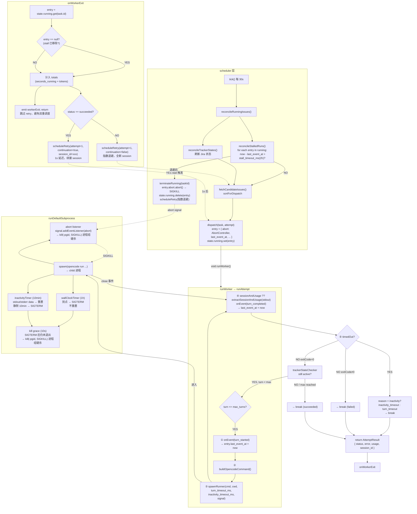
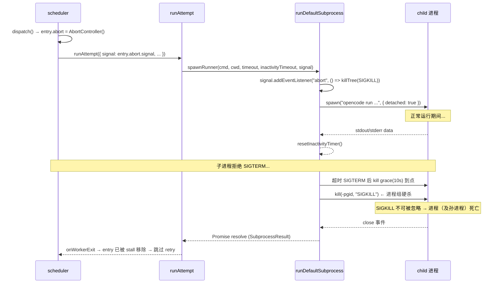
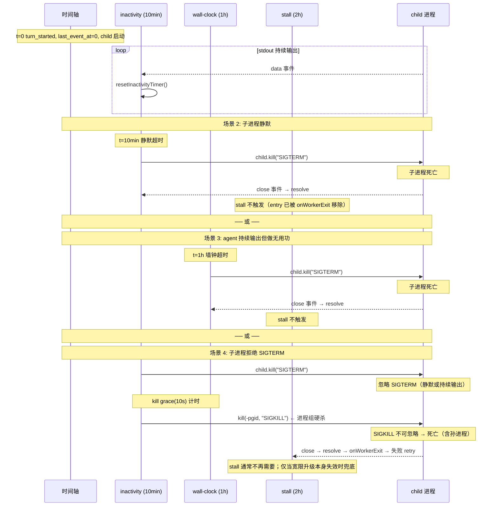

# 三层超时模型

tasking worker 子进程（`opencode run`）使用三层超时保护，各层独立运行，先触发者先终止子进程。子进程层的超时终止带升级：SIGTERM 优雅退出 → 10s 宽限（kill grace）→ 进程组 SIGKILL 硬杀（见 ADR 0020）。

## 模型总览

```
┌─ scheduler 层 ──────────────────────────────────────────────────┐
│                                                                 │
│  stall_timeout_ms（2h）                                         │
│  检测：worker 是否卡死（entry 是否长期滞留 running map）         │
│  终止：通过 AbortSignal → runDefaultSubprocess → SIGKILL        │
│  retry：指数退避，全新 session                                   │
│                                                                 │
├─ subprocess 层（runDefaultSubprocess 内部）─────────────────────┤
│                                                                 │
│  inactivity_timeout_ms（10min）    turn_timeout_ms（1h）        │
│  检测：stdout/stderr 原始字节      检测：总时长                │
│  终止：SIGTERM → 10s 宽限 → 进程组 SIGKILL（两者相同）          │
│  retry：onWorkerExit 失败 retry    retry：onWorkerExit 失败 retry│
│                                                                 │
└─────────────────────────────────────────────────────────────────┘
```

## 整体流程图



## 信号链详图



## 三层触发顺序



## 配置项

| 字段 | 默认值 | 校验 | 禁用 | 层级 |
|------|--------|------|------|------|
| `inactivity_timeout_ms` | 600000（10min） | >= 0 | 设为 0 | subprocess |
| `turn_timeout_ms` | 3600000（1h） | > 0 | 不可禁用 | subprocess |
| `stall_timeout_ms` | 7200000（2h） | >= 0 | 设为 0 | scheduler |

建议 `stall_timeout_ms` > `turn_timeout_ms`，确保 stall 只在墙钟和不活跃均无效时才兜底。

## 各层详解

### 第一层：不活跃超时（inactivity_timeout_ms）

**位置**：`src/worker/runner.ts` → `runDefaultSubprocess`

**机制**：收到 stdout/stderr 数据时重置计时器，静默超过阈值则 SIGTERM 终止。

```
子进程启动 → 启动 inactivityTimer（10min）
  ├─ stdout 有数据 → resetInactivityTimer()（清零重开）
  ├─ stderr 有数据 → resetInactivityTimer()（清零重开）
  ├─ ...持续有数据，计时器不断重置...
  └─ 10min 内零数据 → timer 触发
     → timedOut = true, timedOutReason = "inactivity"
     → child.kill("SIGTERM")（仅父进程，给 opencode 优雅清理其子进程的机会）
     → 10s 内未退出 → kill(-pgid, "SIGKILL") 进程组硬杀（宽限幂等，只设一次）
```

**设计意图**：opencode 在工具执行期间（如 `npm test`、`land_watch.py`）可能不产出 stdout。10 分钟留够常见工具执行余量，仍能抓住模型 API hang 和网络断开。

**与 Symphony 的对应**：Symphony 的 `turn_timeout_ms`（app-server 层）使用 Erlang `receive ... after` 实现同样的不活跃语义。tasking 用 Node.js `setTimeout` + data 事件重置实现等价行为。

### 第二层：墙钟超时（turn_timeout_ms）

**位置**：`src/worker/runner.ts` → `runDefaultSubprocess`

**机制**：从子进程启动开始计时，到点必杀，不因活动重置。

```
子进程启动 → 启动 wallClockTimer（1h）
  ├─ 子进程正常退出 → close 事件 → clearTimeout(wallClockTimer)
  ├─ 不活跃超时先触发 → SIGTERM → 子进程退出 → close → clearTimeout
  └─ 1h 到了 → timer 触发
     → timedOut = true, timedOutReason = "wall_clock"
     → child.kill("SIGTERM")（仅父进程）
     → 10s 内未退出 → kill(-pgid, "SIGKILL") 进程组硬杀
```

**设计意图**：兜住"agent 在做无用功但持续输出"场景（如死循环里不停调工具），不活跃和 stall 都抓不住。

### 第三层：停滞超时（stall_timeout_ms）

**位置**：`src/scheduler/scheduler.ts` → `reconcileStalledRuns`

**机制**：每个 poll 周期（默认 30s）检查 `RunningEntry.last_event_at`，超过阈值则通过 AbortSignal 终止子进程。

```
每个 tick（30s）→ reconcileStalledRuns():
  for each entry in state.running:
    lastActivity = entry.last_event_at ?? entry.started_at
    if now - lastActivity > stall_timeout_ms:
      → terminateRunning(taskId, false, "stalled")
        → entry.abort.abort()  ← AbortController 触发
        → state.running.delete(taskId)  ← 释放 slot
      → scheduleRetry(attempt+1, "stalled", false)  ← 指数退避
```

**`last_event_at` 更新时机**：只在 `runAttempt` 通过 `onEvent` 回调发 `turn_started` / `turn_completed` 时更新。turn 执行期间不更新。

**AbortSignal 信号链**：

```
scheduler dispatch()
  → entry.abort = new AbortController()
  → runWorker: signal: entry.abort.signal → runAttempt(opts)
    → spawnRunner(cmd, cwd, timeout, inactivityTimeout, opts.signal)
      → runDefaultSubprocess(cmd, cwd, timeout, inactivityTimeout, signal)
        → signal.addEventListener("abort", () => kill(-pgid, "SIGKILL"))
        → stall 触发 entry.abort.abort() → 信号到达 → 进程组 SIGKILL
```

**设计意图**：子进程层的宽限升级（SIGTERM→10s→进程组 SIGKILL）已把拒签子进程的 slot 占用压到"超时 + 10s"硬上界，stall 回归真正的最后兜底：抓子进程层整体失效（事件循环卡死、升级路径自身失效、`spawnRunner` 因异常永不返回）的极端场景，从 scheduler 层外部检测 entry 长期滞留并经 AbortSignal 组杀，释放 slot + 重新调度。

## 场景流程

### 场景 1：正常完成

```
t=0       dispatch → entry 创建 → runWorker → runAttempt
          → turn_started 事件 → last_event_at = 0
          → spawnRunner → runDefaultSubprocess → 子进程启动

t=2min    子进程正常退出（exitCode=0）
          → close 事件 → clearTimeout(wallClockTimer) + clearTimeout(inactivityTimer)
          → Promise resolve → spawnRunner 返回
          → turn_completed 事件 → last_event_at 更新
          → onWorkerExit → entry 仍在 running map → status=succeeded
          → scheduleRetry(attempt=1, continuation=true, session_id=xxx)
          → 1s 后 continuation retry

          wall-clock(1h) 不触发 ✅
          inactivity(10min) 不触发 ✅
          stall(2h) 不触发 ✅
```

### 场景 2：不活跃超时

```
t=0       turn_started → last_event_at = 0 → 子进程启动
          → opencode 开始工作，持续输出 JSON events

t=3min    agent 调用长时间工具（如 npm test），opencode 等待工具完成
          → stdout 无输出 → inactivityTimer 不重置

t=10min   inactivityTimer 触发
          → timedOut=true, timedOutReason="inactivity"
          → child.kill("SIGTERM") → 子进程死亡（宽限内优雅退出，不升级组杀）
          → close 事件 → clearTimeout(wallClockTimer + graceTimer)
          → Promise resolve → spawnRunner 返回
          → runAttempt: result.timedOut=true
            → lastStatus="timed_out"
            → lastError="turn N timed out (inactivity_timeout)"
          → onWorkerExit → entry 仍在 running map
            → status=timed_out（非 succeeded）
            → scheduleRetry(attempt+1, continuation=false) ← 指数退避，全新 session

t=10min+ε 下个 tick → stall 检查 running map → entry 已不在（onWorkerExit 移除了）
          → stall 不触发 ✅
```

### 场景 3：墙钟超时

```
t=0       turn_started → 子进程启动
          → agent 持续输出（inactivity 不触发）
          → 但一直在做无用功（如死循环调工具）

t=1h      wallClockTimer 触发
          → timedOut=true, timedOutReason="wall_clock"
          → child.kill("SIGTERM") → 子进程死亡（宽限内优雅退出，不升级组杀）
          → close 事件 → clearTimeout(inactivityTimer + graceTimer)
          → Promise resolve → spawnRunner 返回
          → runAttempt: lastError="turn N timed out (turn_timeout)"
          → onWorkerExit → scheduleRetry(attempt+1, continuation=false)

t=1h+ε    stall 检查 → entry 已不在 → 不触发 ✅
```

### 场景 4：拒签 SIGTERM（静默或持续输出），宽限升级组杀

```
t=0       turn_started → 子进程启动

t=10min   inactivityTimer 触发 → child.kill("SIGTERM")（仅父进程）
          → 子进程忽略 SIGTERM（D 状态/信号捕获）
          → 无 close 事件 → kill grace(10s) 计时开始（幂等，只设一次）

t=10min+10s 宽限到点，子进程仍未退出
          → kill(-pgid, "SIGKILL") ← 进程组硬杀，SIGKILL 不可被忽略
          → 子进程与其孙进程一并终止（不再有孤儿泄漏）
          → close 事件 → Promise resolve → spawnRunner 返回
          → runAttempt: lastError="turn N timed out (inactivity_timeout)"
          → onWorkerExit → scheduleRetry(attempt+1, 指数退避) ← 正常失败 retry

          stall(2h) 不触发 ✅ —— slot 占用被压到"超时 + 10s"硬上界

特别地，若子进程拒签 SIGTERM 但持续输出 token 事件（如 wrapper 捕获信号
后继续跑），事件会刷新 last_event_at —— 旧设计中 stall 因此永不触发、
slot 被无限占用；宽限升级与输出无关，照样在 10s 后组杀，该漏洞关闭。

（stall 仍保留为最后兜底：若宽限升级路径自身失效——事件循环卡死、
close 事件不产生——entry 长期滞留 running map 时由 scheduler 组杀释放）
```

### 场景 5：worker 卡死（spawnRunner 永不返回）

```
t=0       turn_started → 子进程启动
          → 子进程在 spawn() 阶段就卡死（如 fork 失败但未报错）
          → runDefaultSubprocess 的 Promise 永不 resolve

t=10min   inactivityTimer 触发 → child.kill("SIGTERM")
          → 无子进程可杀 / 子进程不响应
          → 无 close 事件 → Promise 不 resolve

t=1h      wallClockTimer 触发 → child.kill("SIGTERM")
          → 同样无效

t=2h      stall 检测 → terminateRunning
          → entry.abort.abort() → AbortSignal → kill(-pgid, "SIGKILL") 进程组硬杀
          → 子进程被杀（或本就无进程）→ close/不产生
          → 如果 close 事件产生 → Promise resolve → onWorkerExit → 跳过 retry
          → 如果 close 事件不产生 → Promise 仍不 resolve
            但 entry 已从 running map 移除 → slot 释放
            scheduleRetry 已调度 → 任务有重试机会

          abort 走进程组硬杀，正常路径不再遗留孤儿孙进程
```

## 错误分类

| 超时层 | 错误类别 | AttemptStatus | 触发条件 |
|--------|---------|---------------|---------|
| 不活跃 | `inactivity_timeout` | `timed_out` | stdout/stderr 10min 无数据 |
| 墙钟 | `turn_timeout` | `timed_out` | 子进程总时长超 1h |
| stall | `stalled` | （scheduler 直接终止） | worker 2h 无 event 退出 |

`AttemptResult.error` 格式：
- `turn N timed out (inactivity_timeout)`
- `turn N timed out (turn_timeout)`
- `stalled`（由 scheduler 设置）

## retry 行为对比

| 触发源 | continuation | 延迟 | session_id | attempt |
|--------|-------------|------|-----------|---------|
| 正常退出（含 max_turns） | true | 1s | 传（续接） | 重置为 1 |
| 不活跃/墙钟超时 | false | 指数退避 | 不传（全新） | +1 |
| stall | false | 指数退避 | 不传（全新） | +1 |

指数退避公式：`10s × 2^(attempt-1)`，上限 `max_retry_backoff_ms`（默认 5min）。

## onWorkerExit 防护

```typescript
private onWorkerExit(task: Task, result: AttemptResult): void {
    const entry = this.state.running.get(task.id);
    this.state.running.delete(task.id);

    // 计入 totals（即使 entry 为 null，token 仍需统计）
    this.state.totals.seconds_running += elapsed;
    this.state.totals.input_tokens += result.usage.input_tokens;
    // ...

    // 如果 entry 已被 stall 移除，跳过 retry（stall 已调度）
    if (!entry) {
        this.emit("workerExit", task.id, result.status);
        return;
    }

    // 正常路径：根据结果调度 retry
    if (normal) scheduleRetry(..., continuation=true, session_id=...);
    else scheduleRetry(..., continuation=false);
}
```

这防止了 stall 触发后子进程延迟退出导致的**双重 retry** 问题。

## 文件索引

| 文件 | 职责 |
|------|------|
| `src/config/config-types.ts` | `OpencodeConfig` 接口 + `DEFAULTS` |
| `src/config/resolver.ts` | 配置解析（`asNumber` + 校验） |
| `src/worker/runner.ts` | `runDefaultSubprocess`（不活跃 + 墙钟 + 宽限升级 + abort 组杀 + stdout 单遍累计）、`runAttempt`（turn 循环 + 分类） |
| `src/scheduler/scheduler.ts` | `reconcileStalledRuns`（stall 检测）、`terminateRunning`（abort + 移除）、`onWorkerExit`（防护 + retry） |
| `src/shared/types.ts` | `RunningEntry`（`last_event_at`、`abort`）、`AttemptStatus` |
